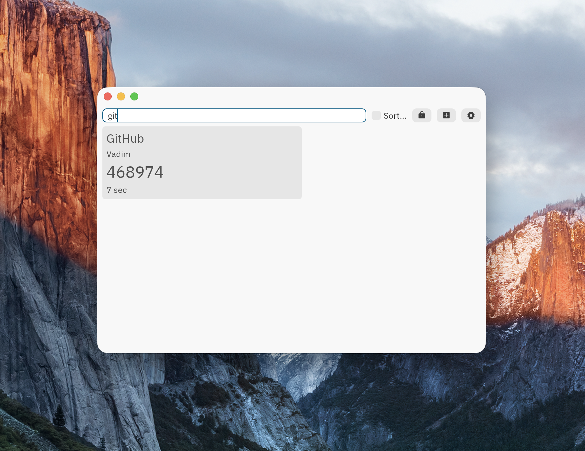
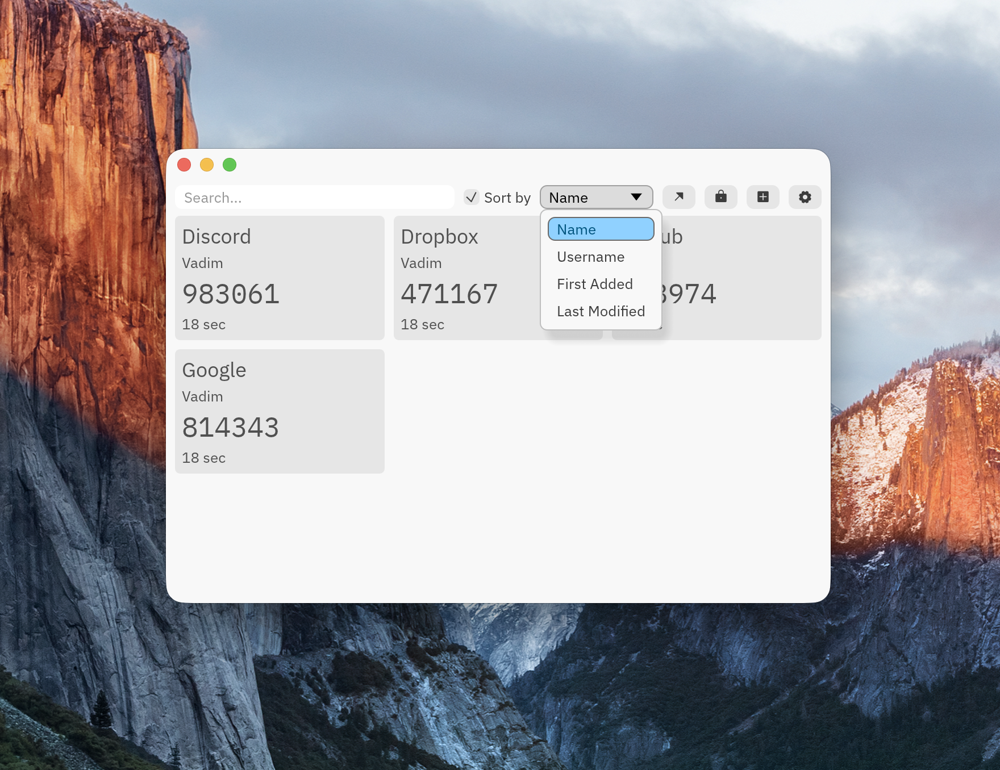

<p align="center">
  
</p>

# Factr.

Opinionated Desktop 2FA TOTP Authenticator Application.

No registration, no servers, fully yours.

No background services, no menu bar widgets, just a fast open then close utility.

## Features

- fast
- minimal
- secure
- Windows, Linux, macOS
- written in Rust
- easy backup and restore

# Install

## Homebrew (macOS 11+)

```sh
brew tap lilvadim/tap
brew install --cask factr
```

## Manually

### Supported Platforms

- macOS: 11+ (Big Sur) Apple Silicon/Intel
- Windows: 10/11 x64/ARM64
- Linux 64-bit: amd64/arm64 glibc 2.35+ (Ubuntu 22.04+, Debian 12+)

[Download from Releases Page](https://github.com/lilvadim/factr/releases/latest)

#### Ubuntu/Debian Based (DEB)

Use this command to install the downloaded package file:

```sh
sudo apt install ./Factr_*_linux-*.deb # Use downloaded package name
```

#### Fedora (RPM)

Use this command to install the downloaded package file:

```sh
sudo dnf install ./Factr_*_linux-*.rpm # Use downloaded package name
```

#### Arch Based

Use this command to install the downloaded package file:

```sh
sudo pacman -U ./Factr_*_linux-*.pkg.tar.zst # Use downloaded package name
```

## Screenshots


<table>
  <tr>
    <td width="50%"></td>
    <td width="50%"></td>
  </tr>
  <tr>
    <td width="50%"></td>
    <td width="50%"></td>
  </tr>
</table>

## Overview

I did not find any decent open source minimal desktop authenticator app, so I decided to make my own.

**It is not a one-day vibecoding session**. I am a backend developer with 4+ years of experience and had experience with building desktop apps "before the AI age".

**Factr is a small utility without any clouds or servers, without any background tray items**, meant for “open, unlock, grab the code, then close” usage. An optional autolock timeout is available for longer sessions.

It’s really simple: the app uses just `~/.config/factr` with `config.json` for settings and `storage.json` for a securely encrypted vault.
Sensitive data is present in memory while the vault is unlocked. On locking, it is cleared from memory where possible. On disk, account data is encrypted.

It uses OS-native security mechanisms so there is no need to set up a new password for this, and it is practically the only method to secure data locally without a huge password to remember.
But you need to **save the recovery key somewhere** as a fallback option or for transferring the vault to another system.

The transfer feature is already built in: just copy the `~/.config/factr` directory and the app will guide you through recovery and setting up system protection on the new system.

See [SECURITY.md](SECURITY.md) for vault encryption, recovery, and system protection.

See [DEVELOPMENT.md](DEVELOPMENT.md) for building, packaging, and project structure.

## Tips

1. While sort is disabled, you can arrange codes as you want just by dragging them!
2. To search by relevance, disable sort after typing in the search bar
3. To transfer to another system, just copy the `~/.config/factr` directory and grab your recovery key
4. You can make the app close automatically after copying the code in settings
5. There is no "batch export" feature for security reasons. But you can copy links one by one to do that. (IMO it is very easy to forget to delete a file with unencrypted secrets on the device)

## Credits

Third-party licenses and attribution notices: [THIRD_PARTY_NOTICES.txt](THIRD_PARTY_NOTICES.txt).
