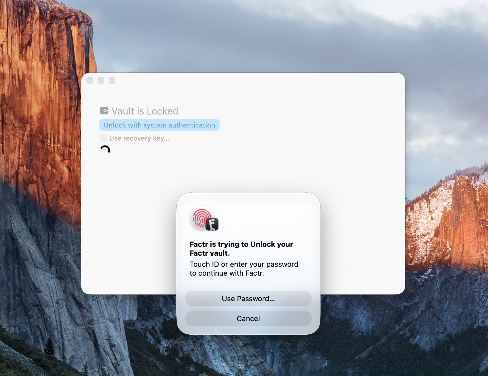

<p align="center">
  
</p>

# Factr.

Opionated Desktop 2FA TOTP Authenticator Application.

No registration, no servers, fully yours.

No background services, no menu bar widgets, just fast open then close utility.

## Features

- fast
- minimal
- secure
- Windows, Linux, macOS
- written in Rust
- easy backup and restore

# Install

## Homebrew (macOS 11+)

```sh
brew tap lilvadim/tap
brew install --cask factr
```

## Manually

### Supported Platforms

- macOS: 11+ (Big Sur) Apple Silicon/Intel
- Windows: 10/11 x64/ARM64
- Linux 64-bit: amd64/arm64 glibc 2.35+ (Ubuntu 22.04+, Debian 12+)

[Download from Releases Page](https://github.com/lilvadim/factr/releases/latest)

#### Ubuntu/Debian Based (DEB)

Use this command to install downloaded package file:

```sh
sudo apt install <DOWNLOADED_PACKAGE>
```

#### Fedora (RPM)

Use this command to install downloaded package file:

```sh
sudo dnf install <DOWNLOADED_PACKAGE>
```

#### Arch Based

```sh
sudo pacman -U <DONWLOADED_PACKAGE>
```

## Screenshots


<table>
  <tr>
    <td width="50%"></td>
    <td width="50%"></td>
  </tr>
  <tr>
    <td width="50%"></td>
    <td width="50%"></td>
  </tr>
</table>

## Overview

I did not found any decent open source minimal desktop authenticator app, so decided to make my own.

**It is not one day vibecoding session**, I am the 4+ years backend developer and had experience with building desktop apps "before AI age".

**Factr is small utility without any clouds or servers, without any background tray items**, oriented on just open, unlock, grab the code, then close usage. But I added autolock timeout so you can keep it opened safely.

Works really simple, app uses just `~/.config/factr` with `config.json` for settings and `storage.json` for securely encrypted vault.
Sensitive data exists only when vault is unlocked, otherwise in memory it fully cleans up or on disk it is fully encrypted.

It uses OS-native security mechanisms so there is no need to setup new password for this, and it is practically the only method to secure data locally without huge password to remember.
But you need to **save somewhere recovery key** as fallback option or for transfer vault to other system.

Transfer feature is already built in, just copy the `~/.config/factr` directory and app will instruct you with recovery and setup system protection on new system.

See [SECURITY.md](SECURITY.md) for vault encryption, recovery, and system protection.

See [DEVELOPMENT.md](DEVELOPMENT.md) for building, packaging, and project structure.

## Tips

1. While sort is disabled, you can arrange codes as you want just dragging them!
2. To search by relevance, disable sort after typing in search bar
3. To transfer to other system just copy `~/.config/factr` directory and grab your recovery key
4. You can make app close automatically after copying the code in settings
5. There is no "batch export" feature for security reasons. But you can copy links one by one to do that. (IMO it is very easy to forget delete file with unencrypted secrets on device)

## Credits

Third-party licenses and attribution notices: [THIRD_PARTY_NOTICES.txt](THIRD_PARTY_NOTICES.txt).
