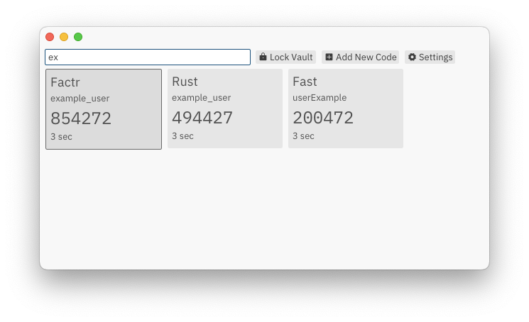
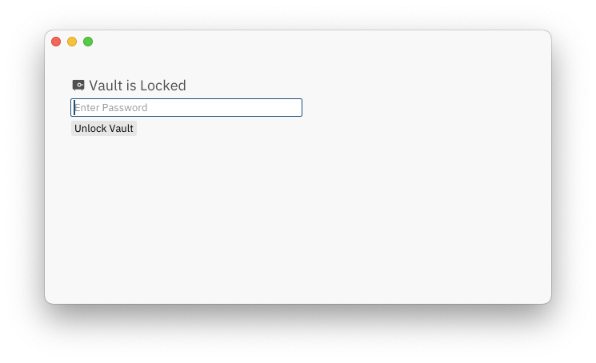
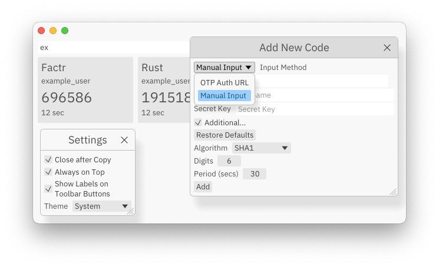

<p align="center">
  
</p>

# Factr.

Desktop 2FA TOTP authenticator application.

# Install

## Homebrew (macOS 11+)

```sh
brew tap lilvadim/tap
brew install --cask --no-quarantine factr
```

## Manually

### Supported Platforms

- macOS: 11+ (Big Sur) Apple Silicon/Intel
- Windows: 10/11 x64/ARM64
- Linux 64-bit: amd64/arm64 glibc 2.35+ (Ubuntu 22.04+, Debian 12+)

[Download from Releases Page](https://github.com/lilvadim/factr/releases)

## Features

- fast
- minimal
- secure
- mostly handcoded
- Windows, Linux, macOS
- written in Rust

## Screenshots




