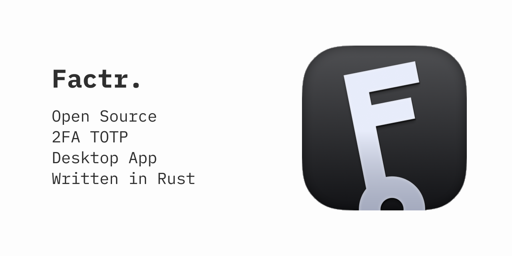
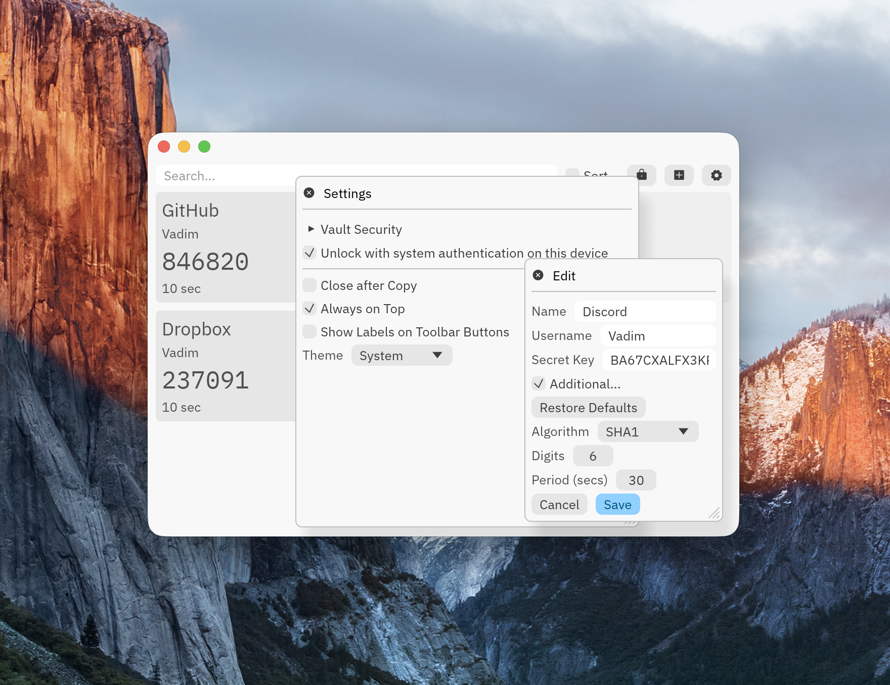

<p align="center">
  
</p>

# Factr.

Opionated Desktop 2FA TOTP Authenticator Application.

No registration, no servers, fully yours.

No background services, no menu bar widgets, just fast open then close utility.

## Features

- fast
- minimal
- secure
- Windows, Linux, macOS
- written in Rust
- easy backup and restore

# Install

## Homebrew (macOS 11+)

```sh
brew tap lilvadim/tap
brew install --cask factr
```

## Manually

### Supported Platforms

- macOS: 11+ (Big Sur) Apple Silicon/Intel
- Windows: 10/11 x64/ARM64
- Linux 64-bit: amd64/arm64 glibc 2.35+ (Ubuntu 22.04+, Debian 12+)

[Download from Releases Page](https://github.com/lilvadim/factr/releases/latest)

#### Ubuntu/Debian Based (DEB)

Use this command to install downloaded package file:

```sh
sudo apt install <DOWNLOADED_PACKAGE>
```

#### Fedora (RPM)

Use this command to install downloaded package file:

```sh
sudo dnf install <DOWNLOADED_PACKAGE>
```

#### Arch Based

```sh
sudo pacman -U <DONWLOADED_PACKAGE>
```

## Tips

1. While sort is disabled, you can arrange codes as you want just dragging them!
2. To search by relevance, disable sort after typing in search bar
3. To transfer to other system just copy `~/.config/factr` directory and grab your recovery key
4. There is no "batch export" feature for security reasons. But you can copy links one by one to do that. (IMO it is very easy to forget delete file with unencrypted secrets on device)

## Screenshots


<table>
  <tr>
    <td width="50%"></td>
    <td width="50%"></td>
  </tr>
  <tr>
    <td width="50%"></td>
    <td width="50%"></td>
  </tr>
</table>

See [SECURITY.md](SECURITY.md) for vault encryption, recovery, and system protection.

See [DEVELOPMENT.md](DEVELOPMENT.md) for building, packaging, and project structure.

## Credits

Third-party licenses and required attribution notices: [THIRD_PARTY_NOTICES.txt](THIRD_PARTY_NOTICES.txt).
